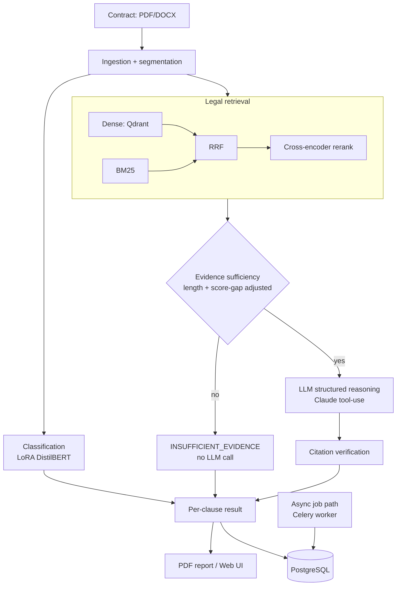

# ClauseGuard

[](https://github.com/nithya-prakash/ClauseGuard/actions/workflows/ci.yml)

AI-assisted first-pass compliance/risk analysis for German contracts.


> **ClauseGuard provides AI-assisted first-pass compliance analysis and does
> not constitute legal advice.** It does not determine whether a contract is
> legally valid. Always consult a qualified lawyer for legal decisions.

## What it does

Upload a German contract (PDF/DOCX) → it's split into clauses → each clause is
classified into one of 10 categories (liability, termination, payment, data
processing, confidentiality, non-compete, IP, warranty, general terms, other) →
the specific German/EU legal provisions relevant to that clause are retrieved from a
curated corpus → an evidence-sufficiency gate checks whether real supporting evidence
was actually found before reasoning proceeds → when an LLM is configured, a
structured, citation-verified risk screening is produced per clause. Results show in
a web UI and export as a PDF report.

The engineering story: LoRA fine-tuning, hybrid retrieval (dense + BM25 + RRF),
cross-encoder reranking, an evidence-sufficiency reliability gate, structured LLM
reasoning, citation verification — all evaluation-driven, with every claimed number
tracing to a committed, reproducible script.

## Architecture



## Technology stack

FastAPI · PostgreSQL + SQLAlchemy + Alembic · Qdrant · Redis + Celery · Next.js 16 +
TypeScript + Tailwind · `distilbert-base-multilingual-cased` + PEFT LoRA ·
`multilingual-e5-small` dense retrieval · `rank_bm25` · cross-encoder reranking ·
Anthropic Claude (tool-use) · reportlab · pytest/ruff/mypy + Vitest/Testing Library ·
Docker Compose · GitHub Actions

## Quickstart

```bash
git clone <this-repo> && cd clauseguard
cp .env.example .env
docker compose up -d --build
QDRANT_URL=http://localhost:6339 python legal_corpus/ingestion/index_corpus.py
open http://localhost:3005
```

No API key is required to run it — the LLM reasoning stage honestly reports itself as
`NOT_CONFIGURED` rather than faking output. Set `ANTHROPIC_API_KEY` in `.env` for real
LLM reasoning. Drive the API directly:

```bash
curl -X POST localhost:8004/documents -F "file=@contract.pdf;type=application/pdf"
curl -X POST localhost:8004/documents/{id}/analyze
curl localhost:8004/documents/{id}/report -o report.pdf
```

Run the evaluation suite (each script writes real output to `reports/`):

```bash
python eval/segmentation/evaluate_segmentation.py
python eval/classification/evaluate_lora.py
QDRANT_URL=http://localhost:6339 python eval/retrieval/evaluate_retrieval.py
QDRANT_URL=http://localhost:6339 python eval/end_to_end/evaluate_end_to_end.py
cd frontend && npm test
```

## Results

Every number below comes from a committed, reproducible eval script — `NOT_MEASURED`
is used explicitly wherever something genuinely hasn't been run.

| Component | Metric | Result |
|---|---|---|
| Segmentation | clause detection | 10/10 |
| Classification (LoRA vs. baseline) | macro F1 | 0.59 vs. 0.547 |
| Retrieval (hybrid + reranker) | Recall@5 / NDCG@5 | 1.0 / 0.951 |
| End-to-end classification accuracy | on the benchmark document | 0.80 |
| Evidence-sufficiency accuracy | original → 2 recalibrations | 0.30 → 0.60 → **0.70** |
| LLM reasoning quality | — | `NOT_MEASURED` (no API key configured) |

## Notable findings

Real problems found by actually running the system, not glossed over:

- **Evidence sufficiency was the project's central reliability problem** — the
  original threshold measured 0.30 accuracy on real clause text (calibrated on short
  queries, it broke on full paragraphs). Two recalibrations later (a length penalty,
  then a score-gap feature — each validated on a true held-out split, with a first
  discarded candidate caught for improving a small split without reducing real error),
  it reached 0.70. **Still not solved**: the adopted fix has a disclosed cost (two new
  false negatives on genuinely multi-topic-covered clauses). Full methodology in
  [reports/evidence_sufficiency/](reports/evidence_sufficiency/).
- **A real cross-container bug**: wiring an async Celery job path, the worker
  container couldn't see files the backend saved — separate containers, separate
  filesystems, no shared volume. Found by actually running it against live Docker
  containers, not by code review; fixed with a shared volume.
- **A real, exploitable PDF-injection bug**: `reportlab`'s `Paragraph` parses markup.
  A clause heading like `<Kundennummer>` (an ordinary German placeholder, no attacker
  intent needed) crashed report generation; a well-formed tag injected live styling.
  Fixed with systematic escaping.
- 10 more real Docker/infra bugs (missing image files, broken CORS, unusable
  healthchecks, etc.) found and fixed by actually deploying — see git history
  (Milestones 12–14).

## Limitations

- Evidence-sufficiency is recalibrated but not solved (see above) — the calibration
  sample (49 examples) is still small.
- No `ANTHROPIC_API_KEY` configured here — reasoning quality is genuinely
  `NOT_MEASURED`, not estimated.
- LoRA classifier is imperfect (macro F1 0.59); legal corpus has gaps (no dedicated
  confidentiality/payment-term provisions).
- The async job path is real and tested but the frontend doesn't use it yet
  (still calls the synchronous endpoint).
- No Playwright end-to-end suite (Vitest tests mock the API layer); rate limiting is
  per-process only (not shared across replicas).

Full detail on all of the above — architecture rationale, security hardening,
environment variables, fine-tuning/retrieval methodology, and the complete
milestone-by-milestone build log — is in `reports/`, `.env.example`, and git history.

## Legal disclaimer

ClauseGuard provides AI-assisted first-pass compliance analysis and does not
constitute legal advice. It does not determine whether a contract is legally valid,
and its risk levels are an AI-generated screening signal, not a legal conclusion.
Always consult a qualified lawyer for legal decisions.
