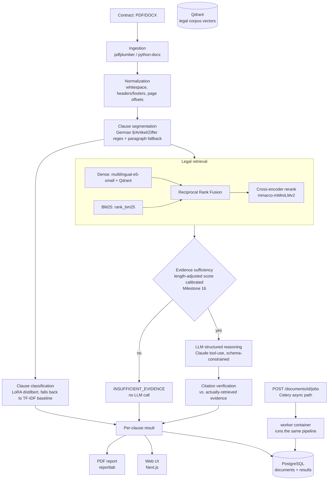

# ClauseGuard

AI-assisted first-pass compliance/risk analysis for German contracts.

> **ClauseGuard provides AI-assisted first-pass compliance analysis and does
> not constitute legal advice.** It does not determine whether a contract is
> legally valid. Always consult a qualified lawyer for legal decisions.

## Status

All 15 originally-planned milestones complete; Milestone 16 (finalization,
calibration, production readiness) is in progress. See commit history / project memory
for milestone-by-milestone progress; the "Failure cases" and "Limitations" sections
below are the honest summary of what actually works, what's genuinely
measured, and what's still open.

- [x] Milestone 1 — Repository architecture, configuration, Docker, FastAPI skeleton
- [x] Milestone 2 — PDF/DOCX ingestion + clause segmentation
- [x] Milestone 3 — Clause classification baseline
- [x] Milestone 4 — LoRA fine-tuning pipeline
- [x] Milestone 5 — Legal corpus ingestion
- [x] Milestone 6 — Dense + BM25 + RRF retrieval
- [x] Milestone 7 — Cross-encoder reranking
- [x] Milestone 8 — Evidence sufficiency + citation verification
- [x] Milestone 9 — LLM structured reasoning
- [x] Milestone 10 — End-to-end pipeline
- [x] Milestone 11 — Evaluation suite
- [x] Milestone 12 — Frontend
- [x] Milestone 13 — PDF report
- [x] Milestone 14 — Security hardening
- [x] Milestone 15 — CI/CD + documentation
- [ ] Milestone 16 — Finalization, calibration & production readiness (evidence-sufficiency
      recalibration done and verified — 0.30→0.60 on the original benchmark; LLM
      evaluation harness built (NOT_MEASURED, no API key); Postgres persistence +
      additive Celery async job path done and verified against real containers — see
      [§15](#15-failure-cases); frontend test suite, a fresh security pass, and
      attempting a real CI push are not yet done)

---

## 1. What ClauseGuard does

A user uploads a German contract (PDF or DOCX). ClauseGuard parses it, splits
it into individual clauses, classifies each clause into one of 10 categories
(liability, termination, payment, data processing, confidentiality,
non-compete, IP, warranty, general terms, other), retrieves the specific
German/EU legal provisions relevant to that clause from a small curated
corpus, checks whether enough real evidence was actually found before
reasoning about it, and — when an LLM is configured — produces a structured,
citation-verified risk screening per clause. Results are shown in a web UI
and can be exported as a PDF report.

It is explicitly **not** a legal-validity checker and does not replace a
lawyer — see [§19 Legal disclaimer](#19-legal-disclaimer).

## 2. Architecture diagram



Postgres now backs both the synchronous `/analyze` endpoint and an additive
async job path (`POST /documents/{id}/jobs` → a real Celery task, run by
the `worker` container, persisting to the same Postgres tables) - Milestone
16 Phase 15. The existing synchronous endpoint and the frontend built
against it are unchanged; the async path is a genuine, tested addition, not
a replacement - see [§5 System pipeline](#5-system-pipeline) and
[§18 Limitations](#18-limitations) for what's still interim (frontend
doesn't use the async path yet).

## 3. Problem definition

Reviewing a contract for obvious compliance red flags — an unenforceable
liability waiver, a missing data-processing agreement, a clause that
contradicts standard-terms law — is routine first-pass work that currently
requires a lawyer's time even when the answer is often "this needs review"
rather than a nuanced legal judgment. ClauseGuard automates that first pass:
it retrieves the *actual* relevant statute text for a clause (not a
paraphrase, not a hallucination) and only reasons about a clause when real
evidence was found, explicitly declining to guess otherwise. It is a
screening aid for a legal team's triage step, not a replacement for legal
review — reinforced throughout the UI, the PDF report, and this document.

## 4. Supported legal scope

Deliberately constrained scope — 15 real legal passages, fetched
programmatically (not hand-typed, not scraped from unofficial sites) from
official sources:

- **BGB** (11 sections) from [gesetze-im-internet.de](https://www.gesetze-im-internet.de)
  (German Federal Ministry of Justice + juris GmbH): §§ 305, 305b, 305c, 306, 307, 308,
  309, 310 (core AGB/standard-terms law) plus §§ 276, 280, 314 (liability, termination).
- **DSGVO/GDPR** (4 articles) from [EUR-Lex](https://eur-lex.europa.eu) (CELEX:32016R0679,
  official EU law portal): Art. 5, 6, 28, 32 (data-processing provisions).

Every passage carries full provenance (source, official URL, section, title, retrieval
timestamp) — see [legal_corpus/metadata/corpus.json](legal_corpus/metadata/corpus.json)
(committed) and [legal_corpus/metadata/scope.json](legal_corpus/metadata/scope.json) for
the machine-readable supported-scope declaration (this exact file is what the PDF
report's "Supported Legal Scope" section renders — one source of truth, not two).

**Confidentiality and payment-term clauses have no dedicated BGB provisions fetched
yet** — a known, documented scope gap (see [§15 Failure cases](#15-failure-cases) for
why this doesn't fail as safely as intended today).

Reproduce: `python legal_corpus/ingestion/build_corpus.py` (fetches fresh from both
official sources; not run in CI because EUR-Lex has been observed rate-limiting
repeated automated requests — see [§15](#15-failure-cases)).

## 5. System pipeline

[`analyze_document()`](backend/app/services/pipeline/document_analysis.py) wires every
stage together: ingest → normalize → segment → *(per clause)* classify → retrieve +
rerank → evidence sufficiency → LLM reasoning → citation verification. A clause-level
failure (no configured LLM, no trained classifier) is recorded on that clause and does
not abort the rest of the document — pipeline failures retain partial progress rather
than losing everything to one stage's failure.

- **Ingestion & segmentation**: PDF via `pdfplumber`, DOCX via `python-docx`
  ([services/ingestion](backend/app/services/ingestion)). Scanned/image-only PDFs are
  detected and explicitly rejected with `OCRNotImplementedError` — OCR is architected as
  a pluggable seam but not implemented, never silently pretended to work. Clause
  segmentation ([services/segmentation](backend/app/services/segmentation)) is
  regex/heuristic-based (German `§`, `Artikel`, `Ziffer`, numbered clauses), with a
  paragraph-based fallback when no numbering pattern is found — never arbitrary
  fixed-size chunking.
- **Classification**: LoRA-fine-tuned `distilbert-base-multilingual-cased`
  (falling back to the TF-IDF baseline if untrained) into the 10-label taxonomy — see
  [§12 Fine-tuning](#12-fine-tuning).
- **Retrieval & reranking**: dense (Qdrant) + BM25 → RRF → cross-encoder rerank — see
  [§13 Retrieval benchmark](#13-retrieval-benchmark).
- **Evidence sufficiency**
  ([evidence_sufficiency.py](backend/app/services/verification/evidence_sufficiency.py)):
  runs on the reranked evidence *before* any LLM call. Recalibrated in Milestone 16
  against a 40-example clause-length benchmark (`reports/evidence_sufficiency/`) after
  the original threshold measured 0.30 accuracy on the real end-to-end benchmark — the
  gate now length-penalizes the cross-encoder score logarithmically, which doubled
  measured accuracy to 0.60 on that same benchmark. Still a real, disclosed limitation,
  not solved — see [§15 Failure cases](#15-failure-cases).
- **LLM structured reasoning**
  ([reasoning/service.py](backend/app/services/reasoning/service.py)): uses Claude's
  tool-use (schema-constrained, not "ask nicely for JSON") so `risk_level` can only ever
  be `LOW`/`MEDIUM`/`HIGH` and `classification` only one of the 10 taxonomy labels — the
  model cannot invent categories. **No `ANTHROPIC_API_KEY` is configured in this
  environment** — verified (not assumed) that the `INSUFFICIENT_EVIDENCE` path never
  touches the LLM, and a clause with sufficient evidence raises `LLMNotConfiguredError`
  with a clear message instead of faking a result. A live-call test exists, gated on the
  key being set — `SKIPPED` today, not deleted or faked.
- **Citation verification**
  ([citation.py](backend/app/services/verification/citation.py)): for every LLM-claimed
  finding, checks the cited section exists in the corpus, was actually retrieved for
  this clause, the claimed evidence text genuinely appears in that passage, and the
  source matches. Any failure → `CITATION_UNVERIFIED` with a specific reason, never
  silently accepted. Tested against constructed adversarial findings (fabricated
  sections, hallucinated evidence text) since no real LLM output exists yet to test
  against for real.
- **Report generation**: real PDF via `reportlab` — see
  [reports/segmentation](reports/segmentation), [§14 Results](#14-results).
- **Frontend**: Next.js 16 (App Router, TypeScript, Tailwind) —
  [frontend/](frontend). Four screens matching spec section 18, all driven by the real
  API, no mock data: **Upload** (drag-and-drop, PDF/DOCX only), **Processing** (real
  per-stage checkmarks computed from the actual response — there's no live progress
  channel yet since analysis runs synchronously, so this is "not started → done", not a
  fabricated animated progress bar), **Results** (classification/risk badges, and a
  distinctly-styled "AI finding" / "Legal source" / "Evidence" block per finding with a
  VERIFIED/CITATION_UNVERIFIED badge — clauses with no configured LLM show a clearly
  different "Reasoning not available" state, never a fake risk level), **Report**
  (triggers a real PDF download).
- **API**: building the frontend required a real REST API that didn't exist yet (the
  spec's section 20 endpoints weren't part of the original 15 milestones' explicit
  scope, but a frontend with nothing real to call would mean fake data). See
  [backend/app/api/routes/documents.py](backend/app/api/routes/documents.py):
  `POST /documents`, `POST /documents/{id}/analyze`,
  `GET /documents/{id}/{clauses,findings,report}`, `DELETE /documents/{id}`. Uploads are
  saved under a server-generated UUID filename (never the client's original filename,
  preventing path traversal). `/analyze` still runs synchronously in a plain `def` route
  handler (FastAPI's threadpool executor, so it doesn't block the event loop) — the
  frontend's existing UX is unchanged.
- **Persistence & async jobs** (Milestone 16 Phase 15): document/result storage moved
  from an interim in-memory dict to real Postgres
  ([store.py](backend/app/services/pipeline/store.py), via SQLAlchemy models + Alembic
  migrations in `backend/migrations/`) — both containers run
  `alembic upgrade head` on startup (`docker/entrypoint.sh`), and the synchronous
  `/analyze` endpoint now persists there too, so results survive a restart. Additively,
  not as a replacement: `POST /documents/{id}/jobs` creates a real job row and enqueues
  a real Celery task ([tasks/analysis.py](backend/app/tasks/analysis.py)), executed by
  the `worker` container and polled via `GET /documents/{id}/jobs/{job_id}` — verified
  end-to-end against the actual running containers, not just unit-tested (see
  [§15 Failure cases](#15-failure-cases) for a real bug this verification caught: the
  worker couldn't see files the backend saved until a shared upload volume was added).
  Unit tests stay fast by swapping in an in-memory SQLite database via dependency
  injection (`backend/tests/conftest.py`); integration tests run against the real
  configured Postgres.

Reproduce end-to-end: `docker compose up -d --build && QDRANT_URL=http://localhost:6339
python legal_corpus/ingestion/index_corpus.py`, then open `http://localhost:3005` and
upload a contract, or drive the API directly — see [§10](#10-running-the-application).

## 6. Technology stack

| Layer | Technology |
|---|---|
| Backend API | FastAPI, Pydantic v2, Uvicorn |
| Database | PostgreSQL + SQLAlchemy + Alembic (backs both document storage and the async job path) |
| Vector store | Qdrant |
| Background jobs | Redis + Celery (additive async analysis path, alongside the synchronous default) |
| Frontend | Next.js 16 (App Router), TypeScript, Tailwind CSS |
| Document parsing | `pdfplumber` (PDF), `python-docx` (DOCX) |
| Classification | `distilbert-base-multilingual-cased` + PEFT LoRA; TF-IDF + logistic regression baseline (`scikit-learn`) |
| Dense retrieval | `intfloat/multilingual-e5-small` (`sentence-transformers`) |
| Lexical retrieval | `rank_bm25` |
| Reranking | `cross-encoder/mmarco-mMiniLMv2-L12-H384-v1` |
| LLM reasoning | Anthropic Claude (tool-use / structured output), configurable, off by default |
| PDF report generation | `reportlab` |
| Training | PyTorch, Hugging Face `transformers` + `peft` |
| Testing | `pytest`, `ruff`, `mypy` |
| CI/CD | GitHub Actions (authored, not yet run — see [§15](#15-failure-cases)) |
| Containerization | Docker, Docker Compose |

## 7. Setup

Prerequisites: Docker + Docker Compose, Python 3.12 (for running scripts/tests outside
Docker), Node.js 22 (for frontend dev outside Docker).

```bash
git clone <this-repo>
cd clauseguard
cp .env.example .env
```

No API keys are required to run the system — `LLM_PROVIDER` defaults to unset and the
reasoning stage honestly reports itself as not configured rather than faking output. Set
`ANTHROPIC_API_KEY` in `.env` if you want real LLM reasoning (see
[§9 Environment variables](#9-environment-variables)).

## 8. Docker usage

```bash
docker compose up -d --build
```

Starts 6 services: `postgres`, `qdrant`, `redis`, `backend`, `worker`, `frontend`. Host
ports are deliberately non-default (5436 Postgres, 6339/6340 Qdrant, 6383 Redis, 8004
backend, 3005 frontend) to avoid clashing with other projects' containers on the same
machine — container-to-container traffic uses the standard ports internally.

The legal corpus must be indexed into Qdrant once after first startup (from the host,
hence the port override — `QDRANT_URL` defaults to the in-Docker hostname otherwise):

```bash
QDRANT_URL=http://localhost:6339 python legal_corpus/ingestion/index_corpus.py
```

The first `/analyze` request downloads ~1GB of models (embeddings, reranker,
classifier) into a persisted named volume (`clauseguard_hf_cache`) — slow once, fast on
every request after, including across container rebuilds.

Tear down: `docker compose down` (add `-v` to also drop the Postgres/Qdrant/model-cache
volumes — not needed for normal use).

## 9. Environment variables

See [.env.example](.env.example) for the full, authoritative list. Summary:

| Variable | Purpose | Default |
|---|---|---|
| `ENVIRONMENT` | `development`/`test`/`production` | `development` |
| `LOG_LEVEL` | structlog level | `INFO` |
| `DATABASE_URL` | Postgres connection string | docker-compose host |
| `QDRANT_URL`, `QDRANT_COLLECTION` | legal corpus vector store | docker-compose host |
| `REDIS_URL`, `CELERY_BROKER_URL`, `CELERY_RESULT_BACKEND` | queue (architected, not yet wired) | docker-compose host |
| `LLM_PROVIDER` | `anthropic` or unset | unset (honest `NOT_CONFIGURED`) |
| `ANTHROPIC_API_KEY` | required only if `LLM_PROVIDER=anthropic` | empty |
| `ANTHROPIC_MODEL` | Claude model id | `claude-sonnet-5` |
| `MAX_UPLOAD_SIZE_MB` | upload size limit | `20` |
| `UPLOAD_ALLOWED_EXTENSIONS` | allowed upload extensions | `.pdf,.docx` |
| `CORS_ALLOWED_ORIGINS` | frontend origins allowed to call the API | `localhost:3005,localhost:3006` |

Contract text is only ever sent to an external LLM API when `LLM_PROVIDER=anthropic`
*and* `ANTHROPIC_API_KEY` is set — see [§17 Privacy](#17-privacy).

## 10. Running the application

```bash
docker compose up -d --build
QDRANT_URL=http://localhost:6339 python legal_corpus/ingestion/index_corpus.py
open http://localhost:3005
```

Or drive the API directly:

```bash
curl -X POST localhost:8004/documents -F "file=@contract.pdf;type=application/pdf"
curl -X POST localhost:8004/documents/{id}/analyze
curl localhost:8004/documents/{id}/findings
curl localhost:8004/documents/{id}/report -o report.pdf
curl -X DELETE localhost:8004/documents/{id}
```

Health check: `curl localhost:8004/health` — reports real per-dependency status
(database/Qdrant/Redis/LLM), not a hardcoded "ok".

## 11. Running evaluation

Every eval script below runs the real pipeline and writes its output to `reports/` —
none of these numbers are hand-typed (see [§14 Results](#14-results) for what they
measured):

```bash
# Segmentation (no external services needed)
python eval/segmentation/evaluate_segmentation.py

# Classification: baseline, then LoRA (see §12)
python training/scripts/prepare_dataset.py
python training/scripts/train_baseline_classifier.py
python eval/classification/evaluate_baseline.py
python training/scripts/train_lora_classifier.py
python eval/classification/evaluate_lora.py

# Retrieval (needs Qdrant + the corpus indexed — see §13)
docker compose up -d qdrant
QDRANT_URL=http://localhost:6339 python legal_corpus/ingestion/index_corpus.py
QDRANT_URL=http://localhost:6339 python eval/retrieval/evaluate_retrieval.py

# End-to-end (needs Qdrant + trained models, all of the above)
QDRANT_URL=http://localhost:6339 python eval/end_to_end/evaluate_end_to_end.py
```

## 12. Fine-tuning

- Base model: `distilbert-base-multilingual-cased` (~135M params) — a small
  multilingual **encoder** with a sequence-classification head, not a
  generative LLM. Chosen because there is no GPU on this machine: LoRA
  adapters on a small encoder train in minutes on Apple Silicon MPS, whereas
  fine-tuning a multi-billion-parameter Qwen/Llama locally would not be
  realistic. Rationale documented in
  [training/configs/lora_classifier.json](training/configs/lora_classifier.json).
- LoRA via PEFT: r=8, alpha=16, target modules `q_lin`/`v_lin`. **745,738 /
  136,078,100 trainable params (0.548%)** — the actual number PEFT reports,
  not an estimate.
- Trained on a 120-example synthetic dataset the developer hand-authored
  (`training/datasets/clause_classification/dataset.json`, see its
  `_provenance` field) — not real contract data, not legally reviewed.
  Deterministic 8/2/2 per-class train/val/test split
  (`training/scripts/prepare_dataset.py`, no randomness).
- Manual PyTorch training loop (not HF Trainer, to avoid pulling in
  logging/reporting integrations), deterministic seed, real training curve
  logged every epoch and preserved in the committed
  [reports/classification/lora/results.json](reports/classification/lora/results.json)
  (`training_history` field; the adapter weights themselves are gitignored
  and regenerated by the training script, not committed as a binary): loss
  2.35 → 0.086, val accuracy 15% → 65-70% over 12 epochs.
- Reproduce: `python training/scripts/train_lora_classifier.py && python
  eval/classification/evaluate_lora.py`

Real measured baseline-vs-LoRA comparison — see [§14 Results](#14-results).

## 13. Retrieval benchmark

- **Dense**: `intfloat/multilingual-e5-small` embeddings, stored in Qdrant
  (`legal_corpus/ingestion/index_corpus.py` embeds and indexes all 15
  corpus passages).
- **BM25**: lexical search over the corpus text (`rank_bm25`), built
  in-memory at query time (corpus is small enough that persistence isn't
  needed yet).
- **Hybrid**: Reciprocal Rank Fusion (`k=60`, standard Cormack et al.
  constant) combines dense + BM25 rankings by position, not raw score — see
  [backend/app/services/retrieval/rrf.py](backend/app/services/retrieval/rrf.py).
- **Reranking**: Dense + BM25 → RRF → top-10 candidate pool → cross-encoder
  (`cross-encoder/mmarco-mMiniLMv2-L12-H384-v1`, small multilingual MiniLM
  trained on mMARCO, covers German) → top-5 evidence. See
  [backend/app/services/reranking](backend/app/services/reranking).

Benchmark: 15 hand-authored queries against the 15-passage corpus — real measured
results in [reports/retrieval/report.md](reports/retrieval/report.md), summarized in
[§14 Results](#14-results). The reranker's recall is bounded by the RRF pool it's
given (top-10) — it cannot recover a relevant passage RRF ranked outside that pool.

Reproduce (from the host, outside Docker, hence the port override): `docker compose up
-d qdrant && QDRANT_URL=http://localhost:6339 python legal_corpus/ingestion/index_corpus.py
&& QDRANT_URL=http://localhost:6339 python eval/retrieval/evaluate_retrieval.py`

## 14. Results

Every number below comes from a committed, reproducible eval script (see
[§11](#11-running-evaluation)) — none are hand-typed or estimated. `NOT_MEASURED` is
used explicitly rather than invented wherever something genuinely hasn't been run.

| Component | Metric | Result | Source |
|---|---|---|---|
| Segmentation | clause detection | 10/10 on the benchmark contract (2 formats) | [reports/segmentation](reports/segmentation) |
| Classification (baseline) | accuracy / macro F1 | 0.60 / 0.547 (N=20 test set) | [reports/classification/baseline](reports/classification/baseline) |
| Classification (LoRA) | accuracy / macro F1 | — / 0.59 (N=20 test set) | [reports/classification/lora](reports/classification/lora) |
| Retrieval — dense | Recall@1 / @3 / @5 / MRR / NDCG@5 | 0.80 / 0.93 / 0.93 / 0.865 / 0.875 | [reports/retrieval](reports/retrieval) |
| Retrieval — BM25 | Recall@1 / @3 / @5 / MRR / NDCG@5 | 0.80 / 0.93 / 0.93 / 0.867 / 0.884 | [reports/retrieval](reports/retrieval) |
| Retrieval — hybrid RRF | Recall@1 / @3 / @5 / MRR / NDCG@5 | 0.80 / 0.93 / 0.93 / 0.864 / 0.875 | [reports/retrieval](reports/retrieval) |
| Retrieval — hybrid + reranker | Recall@1 / @3 / @5 / MRR / NDCG@5 | **0.867 / 1.0 / 1.0 / 0.933 / 0.951** | [reports/retrieval](reports/retrieval) |
| End-to-end — classification accuracy | on the real 10-clause benchmark document | 0.80 | [reports/end_to_end](reports/end_to_end) |
| End-to-end — evidence sufficiency accuracy | vs. human-judged corpus coverage, before/after Milestone 16 recalibration | 0.30 → **0.60** | [reports/end_to_end](reports/end_to_end), [reports/evidence_sufficiency](reports/evidence_sufficiency) |
| Reasoning quality | accuracy / hallucination rate / citation correctness | `NOT_MEASURED` — no `ANTHROPIC_API_KEY` configured | [reports/reasoning](reports/reasoning) |

Two results are worth reading in full rather than just the number:

- **Reranking genuinely helps** at this corpus size (Recall@1 0.80→0.867, NDCG@5
  0.875→0.951) — a real, not-cherry-picked improvement, though the corpus is small
  enough that dense/BM25/hybrid alone are statistically indistinguishable from each
  other.
- **Evidence-sufficiency accuracy doubled (0.30→0.60) after a dedicated Milestone 16
  calibration effort** — still the most important reliability caveat in the whole
  project, and still not solved (full detail: [§15 Failure cases](#15-failure-cases)).

## 15. Failure cases

Real problems found by actually running and testing the system — not a hypothetical
list, and not silently patched where the honest fix was "document the limitation," per
the project's own anti-fabrication policy.

**Evidence-sufficiency threshold was measurably wrong on real clause text — recalibrated
in Milestone 16, still not solved (the biggest, most worked-on finding).** The original
threshold (`MIN_RERANK_SCORE = 0.0`) was calibrated on 4 short standalone queries. On
realistic full-paragraph clause text it was measurably more permissive — 9 of 10
clauses in the original benchmark contract passed the sufficiency check, even though
the corpus has direct legal coverage for only 4 of 10 of that contract's clause
categories, measuring **0.30 accuracy**.

A dedicated 40-example calibration benchmark
([data/benchmark/evidence_sufficiency/](data/benchmark/evidence_sufficiency/dataset.json),
mostly SHORT/MEDIUM/LONG variants of the *same* legal content so length is isolated as
a variable) confirmed the cause directly: false-positive rate rose from **0% (short
clauses) to 100% (medium AND long clauses)** before calibration — the gate had become
almost unable to say `INSUFFICIENT_EVIDENCE` at all once clause text got long. A
logarithmic length penalty on the cross-encoder score (`score - 2.0 * log(length)`,
calibrated on a held-out split, selected only after a recall floor was enforced and a
first candidate was caught and discarded for improving the held-out split without
improving the full-population confusion matrix — see
[reports/evidence_sufficiency/calibration_report.md](reports/evidence_sufficiency/calibration_report.md)
for that full methodology) **doubled measured accuracy on the original, untouched
10-clause benchmark: 0.30 → 0.60**, and reduced the long-clause false-positive rate
from 100% to 25% on the calibration benchmark itself.

**This is not solved.** The held-out calibration set is small (35 conclusive
examples), one real clause (§3, a genuinely-covered termination clause) regressed from
correct to incorrect as a cost of the more conservative rule, and 3 of the 40
calibration examples remain honestly unresolved false positives/negatives — see
[reports/evidence_sufficiency/error_analysis.md](reports/evidence_sufficiency/error_analysis.md)
for the full per-clause breakdown, including the specific adversarial case (a
non-compete clause reusing "Kündigung"/"Vertrag" vocabulary to fool retrieval via
lexical overlap) this recalibration happened to fix as a side effect, not by design.
Still recorded as the top item in [§18 Limitations](#18-limitations), now with a
concrete, more specific next step (a score-gap-to-second-best-passage signal, which the
current 35-example sample is too small to calibrate responsibly).

**The async job path failed 100% of the time until a real Docker verification caught
why (Milestone 16 Phase 15).** After wiring `POST /documents/{id}/jobs` to a real
Celery task run by the `worker` container, the very first end-to-end test against the
live containers (not a unit test - `docker compose up`, real `curl` calls) failed every
job with `"Could not parse the uploaded file - it may be corrupted or not a valid PDF
file"`, even for the known-good benchmark PDF. Cause: `backend` and `worker` are
separate containers with separate filesystems, and there was no shared volume for
uploads - a file the backend saved to its own local `/srv/backend/uploads` simply did
not exist from the worker's point of view. Fixed with a shared named volume
(`clauseguard_uploads`) mounted at the same path in both services; re-verified against
the live containers afterward (`docker compose up -d backend worker`, real upload, real
async job, polled to `COMPLETED` with the correct 10-clause result). The same class of
bug (data invisible across container boundaries) as the Milestone 12 findings - caught
the same way, by actually running it rather than trusting the code review.

**The LoRA classifier misclassifies real clauses.** Macro F1 0.59 on a 20-example test
set is not high, and it showed up in practice: a genuine `§ 4 Haftung` (LIABILITY)
clause from the benchmark contract was misclassified as `NON_COMPETE` during the
end-to-end pipeline run. This did not affect evidence retrieval (which runs on the
clause text, not the classification label), but would affect the classification label
shown to a user.

**A real, exploitable-today PDF-report vulnerability.** `reportlab`'s `Paragraph`
parses its input as a small markup language. Clause `section`/`heading` come directly
from the *uploaded document's raw text*, and were embedded unescaped. Verified with a
completely ordinary input, no attacker intent required: the common German contract
placeholder convention `<Kundennummer>` as a clause heading **crashed report
generation** outright; a well-formed tag like `<font color="red" size="60">` rendered
successfully, letting the uploaded document inject arbitrary styling or a link into
what looks like ClauseGuard's own report. Fixed in Milestone 14 with systematic
escaping — see [§16 Security](#16-security).

**Corrupted uploads used to leak internal exceptions.** A malformed PDF/DOCX (wrong
file renamed, truncated upload) raised a raw `pdfminer`/`python-docx` library exception
that fell through to a generic 500 — safe (no info leak) but misleading, since it
implies a server bug rather than a bad upload. Fixed to a clean 422.

**The Docker deployment had 10 real infrastructure bugs**, found by actually deploying
and using the system rather than trusting `docker compose up` to "just work":

1. The backend image never copied `legal_corpus/metadata/corpus.json` or `training/`
   (classifier models) — would have crashed on the very first real request.
2. `transformers`/`peft` were left in a training-only dependency group, never installed
   in the served backend image, despite being a genuine runtime dependency.
3. CORS only allowed a hardcoded `localhost:3000` that nothing in this project uses —
   every real browser request was silently blocked.
4. Analysis results showed the server-generated UUID filename instead of the user's
   original filename.
5. The Celery worker inherited the backend's HTTP healthcheck and could never pass it
   (nothing listens on port 8000 in a Celery process).
6. The Docker frontend's healthcheck could never pass: Docker auto-sets `HOSTNAME` to
   the container ID, and Next.js standalone binds to it, listening on the wrong
   interface.
7. No persisted Hugging Face model cache — every container rebuild re-downloaded ~1GB
   of models from scratch.
8. No delete/cleanup endpoint existed at all — a direct gap against the spec's privacy
   requirements.
9. Docker Desktop hung for 6+ minutes on `up` under high build-cache disk usage on this
   host (`docker builder prune -f` fixed it — a host resource issue, not a bug in this
   project's config, but real and worth knowing).
10. `docker/backend.Dockerfile`'s `COPY` order for `legal_corpus`/`training` initially
    sat *before* the pip-install layer, meaning every corpus/model change would force a
    full dependency reinstall on the next build — reordered for cache efficiency.

All ten are fixed and verified (unit tests, integration tests, or a live browser
session against the real Docker stack, depending on what each bug actually required to
reproduce) — full detail and exact fixes are in the commit history (Milestones 12–14).

**EUR-Lex intermittently rate-limits repeated automated requests.** Observed during
Milestone 8: after several fetches within one session, `eur-lex.europa.eu` started
returning HTTP 202 with an empty body instead of the real ~800KB regulation text.
`legal_corpus/ingestion/fetch_dsgvo.py` now retries with backoff, but this remains a
real dependency on a third-party site's availability — the two tests that hit it live
are excluded from CI via a dedicated `external_flaky` pytest marker (not from local
runs, where they still serve as real live-fetch verification).

**CI has been authored, not executed.** This repository has no GitHub remote configured
yet — [`.github/workflows/ci.yml`](.github/workflows/ci.yml) was written carefully and
every command in it was independently verified locally throughout Milestones 1–14, but
the workflow itself has never run on a live GitHub Actions runner. Stated here plainly
rather than claiming "CI passes" for something never executed — see
[§20 Future work](#20-future-work).

## 16. Security

Audited spec section 25's checklist against what was already built (file type/size
validation, UUID-based filename sanitization, no path traversal, no execution of
uploaded files, secrets only via environment variables, `.env` gitignored and never
committed — all already true from earlier milestones) and found and fixed three real,
concrete gaps (detailed in [§15 Failure cases](#15-failure-cases)):

1. **PDF report markup/XML injection** — fixed with a `_safe()` XML-escaping helper
   ([pdf_generator.py](backend/app/services/reporting/pdf_generator.py)) applied to
   every value that traces back to the contract, including LLM output
   unconditionally, since that's derived from the same untrusted document and starts
   flowing through this path the moment `ANTHROPIC_API_KEY` is configured. Verified
   with adversarial tests (unbalanced tag doesn't crash; a well-formed injection
   attempt appears as literal text, not live formatting).
2. **Corrupted uploads** now raise a clean `ValidationFailedError` (422) at the
   ingestion boundary ([services/ingestion/service.py](backend/app/services/ingestion/service.py))
   instead of leaking a raw library exception to the generic 500 handler.
3. **No delete/cleanup endpoint** — added `DELETE /documents/{id}`, verified it
   actually removes the file from disk.

**Milestone 16 Phase 17 additions:**

4. **Decompression-bomb protection.** DOCX is a zip archive —
   `MAX_UPLOAD_SIZE_MB` only bounds the compressed upload size, not what it expands
   to. [docx_parser.py](backend/app/services/ingestion/docx_parser.py) now inspects
   the zip's own central directory (metadata only, no decompression) before handing
   the file to `python-docx`, rejecting an unreasonable total uncompressed size
   (200MB) or an implausible compression ratio (100x). PDFs get an analogous cap:
   [pdf_parser.py](backend/app/services/ingestion/pdf_parser.py) rejects more than
   500 pages before extracting any page's text. Both verified with real crafted
   files, not just reasoned about (a genuine zip-bomb-shaped archive and an
   artificially-lowered page cap against a real multi-page PDF).
5. **Rate limiting** on `/analyze` and `POST /documents/{id}/jobs` (the two
   pipeline-triggering endpoints) — a minimal fixed-window limiter per client IP
   ([rate_limit.py](backend/app/core/rate_limit.py)), returning 429 past 10
   requests/minute. Explicitly documented as a real but partial defense, not
   hidden: it's per-process (not shared across multiple backend replicas) and
   trusts the client's reported IP. A production multi-replica deployment would
   want a shared store (this project already has Redis) instead - noted as a
   concrete next step, not silently left as a gap.

**Not addressed this pass, still honestly out of scope:** no magic-byte content
sniffing beyond parse-time validation (which already safely rejects mismatched
content); the `DELETE` endpoint has no frontend UI yet; no automatic job/upload
expiry (manual deletion only).

**Prompt-injection defenses** (spec section 30, built in Milestone 9) in
[prompts.py](backend/app/services/reasoning/prompts.py): the contract clause is
wrapped in a delimiter tag with a random per-request nonce (`secrets.token_hex(8)`) so
an attacker crafting clause text in advance can't forge a matching closing tag;
explicit written instructions (system prompt + inline) that the clause is data, never
commands; a reinforcing instruction placed *after* the untrusted section; structured
tool-use output narrows what an injection could even change. These reduce risk — **they
are not a guarantee**, stated plainly in the code, not oversold. Real adversarial
testing against a live model needs an API key, and is unmeasured today (see
[§14 Results](#14-results)).

**Documented, not silently ignored, as out of scope for this pass**: no magic-byte
content sniffing beyond parse-time validation (which already safely rejects mismatched
content); no decompression-bomb protection for DOCX/PDF (bounded by
`MAX_UPLOAD_SIZE_MB` on the compressed size, not decompressed — a genuinely advanced
attack vector); no rate limiting on `/analyze` (each call is expensive — a real,
undefended DoS vector); the `DELETE` endpoint has no frontend UI yet.

## 17. Privacy

Contract text is never sent to an external LLM API unless `LLM_PROVIDER=anthropic` and
`ANTHROPIC_API_KEY` are explicitly set. With no key configured, the reasoning stage
reports itself as `NOT_CONFIGURED` rather than fabricating output — verified, not
assumed (see [§5](#5-system-pipeline)).

Uploaded files are stored server-side (under a server-generated UUID filename) until
explicitly deleted via `DELETE /documents/{id}`, which removes both the file and its
analysis result from Postgres for that document. There is currently no automatic expiry —
manual deletion is the only cleanup path today (see
[§18 Limitations](#18-limitations)). Logs never contain contract text or clause
content, only metadata (ids, counts, durations, stage names, error types) — see
[backend/app/core/logging.py](backend/app/core/logging.py).

## 18. Limitations

Most actionable first:

1. **Evidence-sufficiency is recalibrated (0.30→0.60) but still not solved.** The
   headline finding of this project, now also its most-worked-on fix — see
   [§15 Failure cases](#15-failure-cases) and
   [reports/evidence_sufficiency/](reports/evidence_sufficiency/) for the full
   methodology, held-out numbers, and honest remaining error analysis. Next step: a
   score-gap-to-second-best-passage signal (a large gap plausibly indicates a genuinely
   dominant match regardless of length) — the current 35-example calibration sample is
   too small to fit this responsibly without a larger benchmark first.
2. **Legal corpus has gaps** — no BGB provisions for confidentiality or payment-term
   clauses. Combined with limitation 1, both `§ 6 CONFIDENTIALITY` and `§ 2 PAYMENT`
   incorrectly passed the sufficiency check in the end-to-end run rather than
   correctly reporting `INSUFFICIENT_EVIDENCE`.
3. **No `ANTHROPIC_API_KEY` configured in this environment** — the reasoning stage is
   fully built and tested for its gating behavior, but has not produced a single real
   reasoning result. `reports/reasoning/` is an explicit `NOT_MEASURED` stub. Real
   hallucination/faithfulness testing also needs a key.
4. **LoRA classifier is imperfect** (macro F1 0.59) — see the real misclassification
   example in [§15](#15-failure-cases).
5. **Document/analysis storage is now Postgres-backed and durable (Milestone 16 Phase
   15)** — this used to be the top item here; see [§15](#15-failure-cases) for what
   changed. Remaining gap: no Alembic migration has been tested as part of an upgrade
   from a running production instance with real data (only from empty databases so far)
   — a real concern before ever redeploying against non-empty data.
6. **The Celery async job path is real, tested, and additive — but the frontend
   doesn't use it yet.** `POST /documents/{id}/jobs` genuinely works end-to-end against
   the real `worker` container (see [§15](#15-failure-cases)), but the frontend still
   calls the synchronous `/analyze` endpoint, so a user gets no progress polling or
   retry benefit from the job queue today. No job cleanup/expiry exists either — old
   `analysis_jobs` rows accumulate indefinitely.
7. **Frontend has a real automated test suite now (Milestone 16 Phase 16)** — Vitest +
   Testing Library, 20 tests covering upload/loading/findings/insufficient-evidence/
   citation-display/report/error states. Still no Playwright end-to-end suite driving
   an actual browser against the real backend - the current tests mock the API layer.
8. **Rate limiting exists but is minimal** (Milestone 16 Phase 17) — a per-process,
   per-IP fixed-window limiter on `/analyze` and `POST /jobs`. Not shared across
   multiple backend replicas, and trusts the client's reported IP - see
   [§16 Security](#16-security).
9. **Decompression-bomb protection exists for DOCX/PDF now** (Milestone 16 Phase 17) —
   zip-metadata and page-count caps, see [§16 Security](#16-security). Not a complete
   defense against every resource-exhaustion vector (e.g. deeply nested PDF object
   graphs are not specifically checked).
10. **The `DELETE /documents/{id}` endpoint has no frontend UI** yet.
11. **CI has never run against a real GitHub Actions runner** — see
    [§15](#15-failure-cases) and [§20](#20-future-work).
12. **No automatic upload expiry** — cleanup is manual-only today (see
    [§17 Privacy](#17-privacy)).

## 19. Legal disclaimer

ClauseGuard provides AI-assisted first-pass compliance analysis and does not
constitute legal advice. It does not determine whether a contract is legally
valid, and its risk levels (`LOW`/`MEDIUM`/`HIGH`/`INSUFFICIENT_EVIDENCE`) are
an AI-generated screening signal, not a legal conclusion — stated in the system
prompt given to the LLM, in the PDF report (cover and every page's footer), and
in the web UI. Always consult a qualified lawyer for legal decisions. This
disclaimer is not a formality bolted onto the README; it shapes real
engineering decisions throughout the project — for example, the evidence
sufficiency gate exists specifically so the system declines to reason about a
clause rather than guess when it has no real legal basis to reason from.

## 20. Future work

Roughly in order of what would most improve the honest measured numbers above:

1. Grow the evidence-sufficiency calibration benchmark beyond 35 examples and add a
   score-gap-to-second-best-passage signal (see [§15](#15-failure-cases) and
   [reports/evidence_sufficiency/error_analysis.md](reports/evidence_sufficiency/error_analysis.md))
   — the recalibration done so far (0.30→0.60) is real but the false-positive rate on
   long clauses is still 25%, not 0%.
2. Configure `ANTHROPIC_API_KEY` and measure real reasoning/citation/hallucination
   numbers (currently all `NOT_MEASURED`), including real adversarial prompt-injection
   testing against a live model.
3. Extend the legal corpus to cover confidentiality and payment-term provisions.
4. Migrate the frontend's analyze flow from the synchronous `/analyze` call to the
   already-working async `POST /documents/{id}/jobs` + polling path (Milestone 16 Phase
   15), for real progress feedback instead of one long blocking request.
5. Add job cleanup/expiry for old `analysis_jobs` rows, and test an Alembic upgrade
   against a database with real pre-existing data, not just an empty one.
6. Add a Playwright end-to-end suite for the frontend that drives a real browser
   against the real backend (the Milestone 16 Phase 16 Vitest suite mocks the API
   layer - real, but not a substitute for a true end-to-end check).
7. Move rate limiting to a shared store (Redis, already in the stack) so it works
   correctly across multiple backend replicas, not just a single process.
8. Wire the `DELETE /documents/{id}` endpoint into the frontend UI, and add automatic
   upload expiry.
9. Push this repository to GitHub and actually run
   [`.github/workflows/ci.yml`](.github/workflows/ci.yml) for the first time —
   currently authored and locally-validated only (see [§15](#15-failure-cases)).
10. Expand the retrieval/end-to-end benchmarks beyond 15 hand-authored examples — the
    current results (§14) demonstrate the pipeline works correctly, not that it
    generalizes to a larger real-world corpus.
